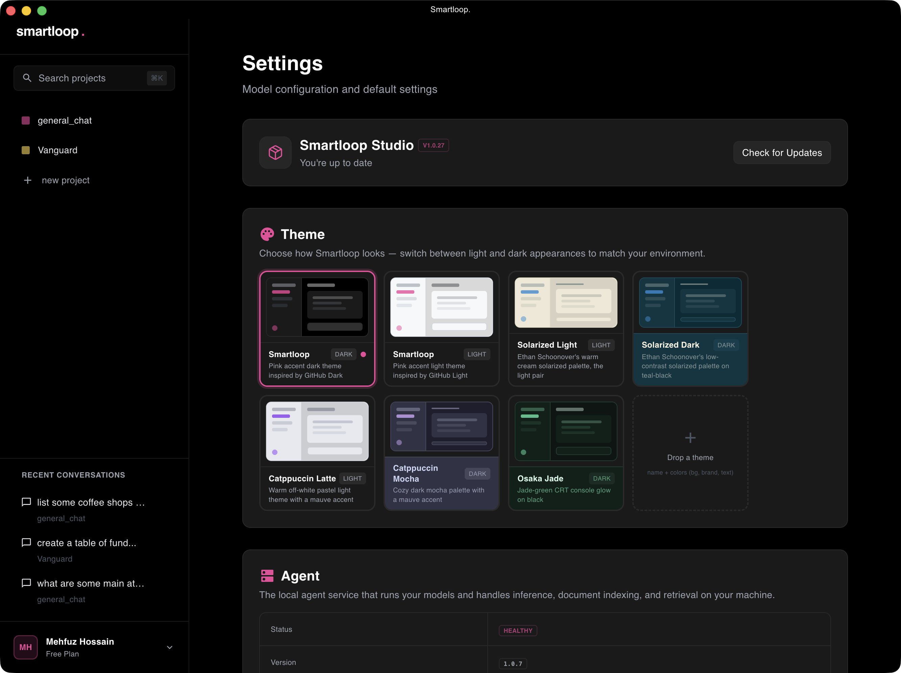

# Smartloop Studio — Community Themes

A community collection of drop-in themes for [Smartloop Studio](https://github.com/smartloop-ai/smartloop-studio).

Each theme is a single `.yaml` file. Grab one, drop it into the app, and you're
done — no rebuild, no restart. Contributions welcome.

## Themes

| Theme | Mode | Description |
|---|---|---|
| [Dracula](themes/dracula.yaml) | dark | Classic Dracula — dark slate with a purple accent |
| [Gruvbox](themes/gruvbox.yaml) | dark | Warm retro brown with a golden accent |
| [Nord](themes/nord.yaml) | dark | Cool arctic slate with a frost-blue accent |
| [Mario](themes/mario.yaml) | dark | Red hat, coin gold and a night-castle sky |
| [Minecraft](themes/minecraft.yaml) | dark | Grassy blocky world — full palette, pixel font, and custom rail icons |

## Installing a theme

1. Download the `.yaml` file you want from [`themes/`](themes/).
2. Open Smartloop Studio → **Settings → Theme**.
3. Drop the file onto the **`Drop a theme`** tile (the dashed **`+`** tile in the Theme grid).



That's it — the theme is imported, applied, and saved. Imported themes get a
`custom-*` id so they never clobber a built-in.

## Authoring your own theme

A theme can be as small as three colors — the app derives a full, cohesive
palette (surfaces, borders, a muted-text ramp, status colors) from your base
background, brand accent, and text color:

```yaml
name: My Theme
mode: dark            # "dark" or "light"
description: A short one-liner
colors:
  bg: '#282a36'       # base background
  brand: '#bd93f9'    # accent color
  text: '#f8f8f2'     # primary text
```

Or specify the **full** palette for pixel-perfect control. Any nested value you
provide is overlaid on top of the derived palette, so you only override what you
care about:

```yaml
colors:
  bg:     { base: '', surface1: '', surface2: '', surface3: '', input: '', elevated: '' }
  brand:  { primary: '', hover: '', active: '', light: '' }
  text:   { primary: '', secondary: '', tertiary: '', muted: '', disabled: '', faint: '' }
  status: { error: '', success: '', online: '', warning: '', info: '', purple: '' }
  border: { subtle: '', default: '', hover: '', code: '' }
  table:  { head: '', hover: '', stripe: '', inlineCode: '' }
```

All colors must be 6-digit hex (`#rrggbb`).

### Fonts (optional)

```yaml
font:
  family: "'VT323', ui-monospace, monospace"     # required if `font` present
  heading: "'Press Start 2P', monospace"         # optional
  url: 'https://fonts.googleapis.com/css2?...'    # optional — must be https
```

### Custom rail icons (optional)

Reskin the sidebar rail with your own inline SVGs. Use
`stroke="currentColor"` / `fill="currentColor"` so icons inherit the rail's
muted and active states. Supported keys: `models`, `documents`, `mcp`,
`skills`, `settings`.

```yaml
icons:
  models: '<svg width="18" height="18" viewBox="0 0 16 16" ...>...</svg>'
```

> Imported YAML is treated as untrusted: rail-icon SVGs are sanitized
> (`<script>`, `on*=` handlers, and `javascript:` URLs are stripped), and font
> URLs must be `https`. See [`minecraft.yaml`](themes/minecraft.yaml) for a
> complete, richly-commented reference theme.

## Contributing

1. Fork this repo.
2. Add your theme as `themes/<name>.yaml`.
3. Add a row to the table above.
4. Open a pull request.

Keep it tasteful, make sure text stays readable against the background, and give
it a short, descriptive one-liner.

## License

studio-themes is source-available under the [Business Source License 1.1](LICENSE) (`BUSL-1.1`).

- You may read, modify, self-host and use it in production, including inside your company.
- You may not offer it to third parties as a hosted or embedded commercial product that competes with Smartloop's paid offerings.
- Each version converts to the [Apache License 2.0](https://www.apache.org/licenses/LICENSE-2.0) four years after it is published.

For a commercial license or questions, contact [hello@smartloop.ai](mailto:hello@smartloop.ai).

Versions released before November 27, 2026 remain available under the MIT License to anyone who received them under it.
